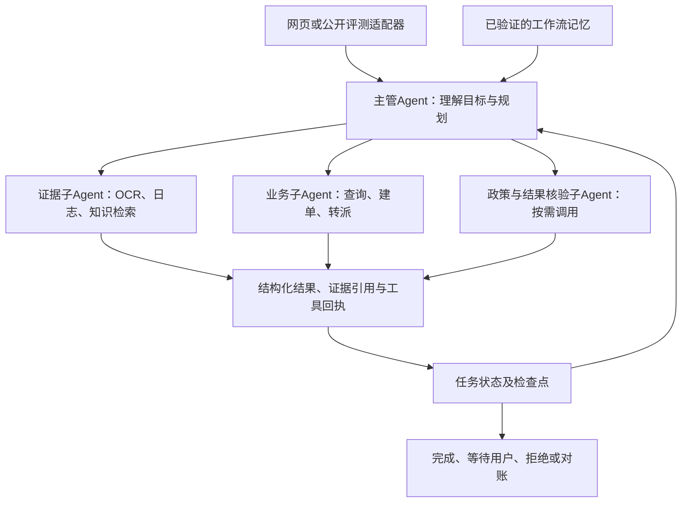

# 企业多Agent项目深挖与重构方案

日期：2026-11-14。阶段：成熟实现源码调研与设计。用户要求后续交付包含实质策略模块复用、算法机制和可验证行为变化；手写提示、正则和局部规则修补作为工程修复记录。

## 推荐主线

将现有项目推进为“面向企业故障处理、可恢复协作与工作流记忆的多Agent Harness”。主线包含两个相互独立可验收的能力：

1. 复用成熟运行时，完成统一的任务协作、上下文管理、证据交接和故障续办。
2. 从实际执行轨迹自动归纳可复用流程，在独立任务变体上验证，再发布版本化工作流记忆。

已有知识库、账户权限、工单API、OCR/日志解析、网页和实验工具继续构成业务底座。任务场景以截图/日志故障排查、知识检索、已有工单查询、确认建单/转派及后续核验为主。主管保持为Agent，负责理解、规划、委派、澄清与重规划。

## 当前代码审阅

- 产品业务路径：`kb/business_runtime.py` → `kb/backends/business_multi_v6.py`，使用已有领域路由、任务列表及业务Worker。
- 公开ITSM路径：`kb/benchmark/crm_adapter.py` → `kb/benchmark/crm_supervisor.py`，使用另一套主管/专业Agent循环及自然语言契约识别。
- 两条路径共享部分工具控制，但主管、任务语义、上下文与收尾并不统一。公开任务改动不等同于网页具备了同样的协作能力。
- 当前八条人工经验主要由`kb/experience.py`提供。BM25、领域与阶段过滤是检索基础；轨迹归纳、独立收益验证、自动维护尚需建设。
- 最新完整成绩：experience v2为50/66、官方47/66；旧r2为53/66。v2的11条长循环占候选Token的68.45%。请求误判、证据刷新和终态错误必须在重构验收中复现和解决。

## 已核对的上游模块及采用方式

| 来源 | 实际代码/机制 | 本项目采用方式 |
|---|---|---|
| [DeepAgents](https://github.com/langchain-ai/deepagents) | `SubAgentMiddleware`、结构化子任务输出、上下文隔离、摘要及大结果外置、LangGraph持久化 | 作为在线Harness主体。优先直接调用上游API；现有业务工具通过适配器接入 |
| [LangMem](https://github.com/langchain-ai/langmem) | `create_memory_manager`、`create_memory_store_manager`，Pydantic Schema抽取、增量维护及LangGraph Store集成 | 提供实际的工作流记录提取与更新模块，替代人工维护SEED条目 |
| [Agent Workflow Memory](https://github.com/zorazrw/agent-workflow-memory) | `mind2web/offline_induction.py`等，将具体执行示例归纳为可复用流程；[论文](https://arxiv.org/abs/2409.07429) | 采用“轨迹→通用子流程→新任务调用”的离线归纳机制，将网页观测/动作适配为企业工具观测/动作 |
| [ACE](https://github.com/ace-agent/ace) | `ace/core/reflector.py`和`curator.py`：基于反馈分析条目、增量ADD/UPDATE/MERGE/DELETE；[论文](https://arxiv.org/abs/2510.04618) | 借鉴反馈维护与增量更新机制。通过LangMem记录统一Schema，避免另起一套不兼容记忆库 |
| [Magentic-One](https://arxiv.org/abs/2411.04468) | 任务账本、进度账本、循环检测及停滞后重规划 | 将该机制用于复杂工作流和故障恢复；保留真实工具证据，主管据此作结构化进度决策 |

代码核对细节：DeepAgents子Agent中间件已经支持结构化结果，并处理末尾空AIMessage；当前实现直接读取最后一条content并抛异常。上游中间件在隔离模式下不把完整父消息历史自动塞给子Agent，而是交接委派任务；这些是可直接复用的行为。

复用范围说明：AWM原代码面向Mind2Web/WebArena，需要工具轨迹和数据格式适配；ACE README仍将工具调用适配列为后续事项，其示例大playbook预算也不适合当前8K上下文。两者提供研究机制与参考代码，企业工具适配、工作流验证及记忆发布由本项目完成。

维护状态：AutoGen当前README已标记归档，并指向[Microsoft Agent Framework](https://github.com/microsoft/agent-framework)。本项目保持LangGraph技术栈，引用Magentic-One设计和源码，不增加已归档框架依赖。

版本兼容：查到的DeepAgents为0.7.38，要求LangChain>=1.5.0、langchain-core>=1.8.0；当前业务锁定为1.4.7/1.7.3。因此先在`/data/zjr/enterprise_kb_agent/`的独立候选环境验证依赖和本地模型协议，运行稳定后再接入业务入口。上游引用、所读文件blob SHA及观察到的仓库HEAD保存在`/data/zjr/enterprise_kb_agent/artifacts/harness_redesign_20261114/upstream_sources.json`。

## 在线协作：共享执行核心，两类业务适配器



### 实际替换内容

- 用DeepAgents原生子任务机制替换CRM中手写的`specialist()`消息和结果拼装；各子Agent输出结构化结果：任务状态、证据引用、已执行动作、缺失信息及需要主管决策的事项。
- 网页和CRM只适配身份、会话、工具目录及结果格式，共享主管/专业Agent执行核心。基准适配器不能额外读取评分条件来决定行动。
- 任务含义由主管通过模型结构化输出形成；自然语言正则退出核心规划路径。用户原话和来源轮次保留，用于绑定身份、对象、备注原文和澄清信息。
- 简单查询允许主管直接使用读取工具；复杂、多来源任务再委派。主管始终是Agent，委派决策由模型结合任务和工具能力作出。
- 复杂任务中采用Magentic-One的任务/进度分离：目标与事实长期保留，进度随观察更新；只有无进展、证据冲突或业务失败时触发重规划。
- 子Agent只收到当前子任务所需的信息。大OCR文本、文档片段和工具原始结果放任务工作区，主上下文保留摘要及可追溯引用。业务回执和权限证明保存在结构化状态，不靠语言模型摘要恢复。
- 保留鉴权、工具Schema、幂等、预算和真实回执等工程约束；实际权限判断仍由业务后端提供。

### 需要完整打通的恢复路径

1. 用户补充对象或身份后，继续原任务中尚未完成的步骤。
2. 任务被拒绝或取消后进入终态；新的授权、主体或业务状态变化才触发重新评估。
3. 后端已经提交但响应丢失时，通过操作记录/允许的查询工具对账，避免重放写入。
4. 专业Agent空输出、工具参数错误或证据冲突时，在共享预算内恢复或重规划。
5. 进程中断后从检查点恢复，保留已执行动作、待办、原始证据和剩余预算。

恢复必须通过真实业务状态和回执验收，不能仅以“模型说完成了”作为判断。

## 离线学习：可验证的工作流记忆

```text
开发任务运行
→ 对话/工具观测/回执轨迹导出
→ AWM式通用工作流归纳
→ LangMem结构化提取和更新
→ ACE式反馈分析与增量整理
→ 独立变体上的有/无记忆重新执行
→ 发布候选工作流版本
→ 在线按任务和状态选择性加载
```

### 工作流记录

记录包含来源轨迹、适用目标、参数槽位、前置条件、步骤与依赖、可接受的完成证据、失败分支、停止条件、验证记录和版本。参数使用当前任务值，不携带示例工单号或用户身份。

例如，从不同对象的实际成功轨迹归纳出“变更负责人并核实”的流程：先查询对象状态，确认可转派及目标主体，执行授权变更，再根据用户目标核对结果；如果对象未分配、身份不足或请求仅为评估，则选择对应分支。这一流程应由轨迹归纳得到，并在改变对象、权限和目标表述的变体上检验。

### 学习与发布机制

- 归纳输入只包含模型可见对话、工具观测和实际业务反馈。原始评测文件中的`expected_actions`、预期答案和测试任务ID不进入归纳输入。
- 模型生成的是候选工作流。结构和工具Schema检查负责可执行性；新环境上的实际运行负责效果验证。
- 验证时让同一模型在重置环境下分别使用和不使用候选工作流，重新完成任务。回放一条旧成功轨迹不能替代收益验证。
- 反馈覆盖成功、失败、误触发、额外动作和调用成本。观察统计与配对验证结果分别存储，不把“任务成功”直接当成“所用每条经验都有效”。
- 合并、更新和淘汰按证据记录；在线加载固定版本。离线归纳与审核不叠加到每个在线用户请求。

这部分的实质交付是自动归纳器、结构化记忆存储、增量维护、验证执行器和版本发布流程；人工示例仅用于Schema说明或开发验收。

## 业务场景和评测

### 主要展示链路

员工提交故障截图/日志和处理诉求；证据子Agent提取环境、错误码并检索知识库；主管结合已有工单和用户补充信息安排后续步骤；需要写入时完成现有确认流程；业务子Agent执行建单或转派并返回回执；出现中断、工具异常或部分失败时继续剩余工作。

该链路包含多来源信息、跨轮澄清、业务写入和恢复，适合检验协作机制。单步查工单继续保留为效率及回归场景。

### 对照和指标

- 成熟基线：DeepAgents原生配置接相同企业工具，使用相同模型、可见输入及预算。
- 主要候选：同一在线核心加经过验证的工作流记忆；其他配置保持一致。
- 原官方GraphAgent、旧r2及既有公开成绩作为历史与业务参考。
- 成功率：工具事实/最终数据库状态、必要沟通和权限约束共同判定。
- 效率：每成功任务Token、模型调用、任务墙钟p50/p95、冗余工具尝试；公开脚本所需显式重复查询不算无效调用。
- 恢复：响应丢失后重复提交数、中断续办完成率、已完成步骤保留率、剩余目标完成情况。
- 记忆：独立变体上的增益、误触发/有害率、提炼审核成本及候选晋升记录。
- 多模态：字段/证据定位、知识依据和后续工单动作的端到端正确性，复用当前截图开发材料并补少量未用过的样例。

公开ITSM66题已多次用于诊断，继续作为公开开发对照保留原始口径。泛化验证需要冻结新的独立变体，或采用[τ²-bench](https://github.com/sierra-research/tau2-bench)官方划分中的小规模未用任务。该项目的[评测实现](https://github.com/sierra-research/tau2-bench/tree/main/src/tau2/evaluator)区分环境状态、动作和沟通，可借鉴其状态评测结构。企业长工作流设计也可参考[TheAgentCompany](https://github.com/TheAgentCompany/TheAgentCompany)，首阶段沿现有环境建设，不引入整套公司仿真基础设施。

## 交付顺序与资源

### 第一批：运行核心迁移

独立环境及固定上游版本；DeepAgents子任务、上下文与检查点接入；共享工具适配器；网页/CRM同一核心；覆盖查询、澄清、写入、拒绝和中断的端到端任务。交付成熟框架基线、恢复证据和成本报告。

### 第二批：工作流学习闭环

首批按约50条开发轨迹限制归纳规模；实现LangMem结构化提取与维护、AWM式归纳、反馈整理和独立配对验证；发布可查询来源和验证记录的工作流版本。交付由运行数据产生的工作流及实际收益/损害记录。

### 第三批：企业多模态端到端与公开对照

把截图/日志、检索、确认建单及续办完整接入；短案例和故障注入通过后，再运行较大公开目录，分析多轮可靠性与每成功任务成本。

资源：复用本地Qwen3-8B与CPU OCR，Agent角色共享一个模型服务；一张3090可顺序执行，第二张可用于并行开发评测/离线归纳。首阶段不需要模型后训练或新增大权重下载。工程工作量按约3—5个开发日估计，包含依赖兼容、两类适配器、恢复与学习验证；GPU测试按阶段分批进行，实际耗时写入报告。

实现中的缓存、环境、临时文件、候选工作流、日志和输出全部放`/data/zjr/enterprise_kb_agent/`。复用代码保留上游版本和许可证信息，适配部分单独记录。

## 后续改动的交付依据

每项策略交付都应提供：采用的上游模块或论文机制、代码接入位置、输入输出和生命周期、实际运行轨迹、与成熟基线的对照以及成本记录。提示词与工具说明是机制的一部分；模块替换、工作流归纳、验证更新和真实行为变化共同构成完成条件。
