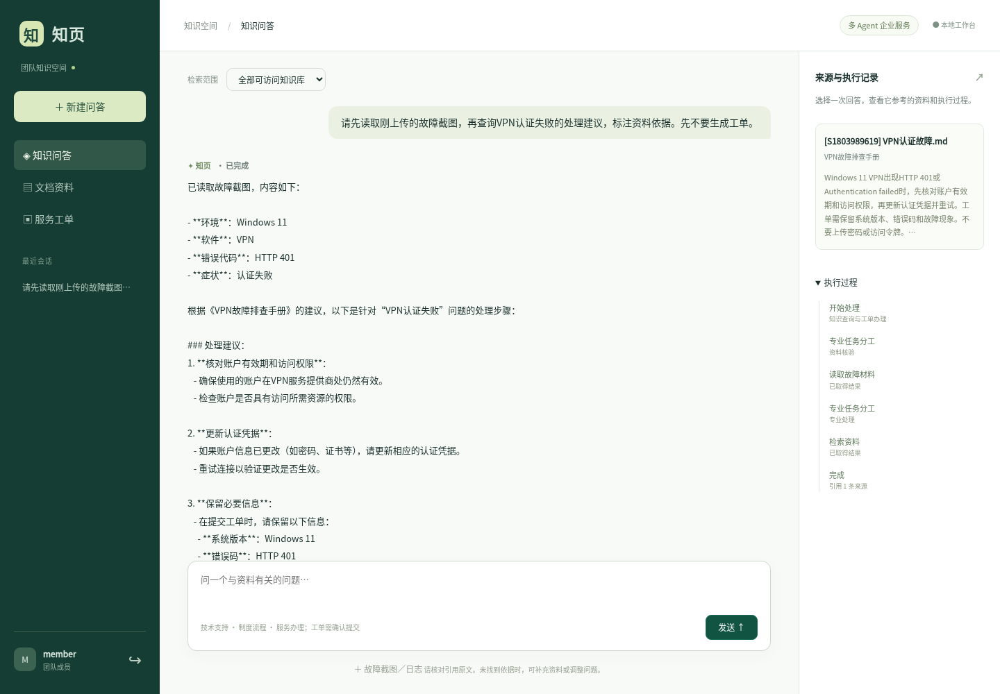

# 企业多 Agent 网页操作演示

[播放或下载完整操作录屏](01-native-service-workflow.mp4)

该录屏来自 2026-11-15 `business_native_v1` 的实际本地部署，使用真实 Qwen3-8B、
OCR、知识检索、HTTP 和数据库。演示使用合成 VPN 故障材料及本地测试账号、资料和工单。

1. 上传故障截图，核对系统、软件、错误码和故障现象。
2. 专业 Agent 检索知识库，返回带引用的排查建议。
3. 多轮追问创建草稿，成员显式确认，管理员接单并解决。
4. 成员在同一会话查询真实状态；另一个草稿由成员取消。

| 环节 | 截图 |
| --- | --- |
| 故障截图与 OCR | [查看](01_screenshot.png) |
| 专业 Agent 与草稿 | [查看](03_native_draft.png) |
| 管理员处理 | [查看](04_admin_resolution.png) |
| 成员跟进状态 | [查看](05_member_followup.png) |

录屏仅转为 MP4，保留连续操作与原始等待时间，时长约 1 分 56 秒。
[浏览器业务检查](../releases/20261116/browser-checks.json)覆盖显式确认、重复确认幂等、
跨账号隔离、管理员处理、状态查询和取消。

[最新源码及固定版本](../versions.md)。11 月 16 日新增的模型网关接入另有
[真实 HTTP 与用量核对记录](../model-gateway.md)。
