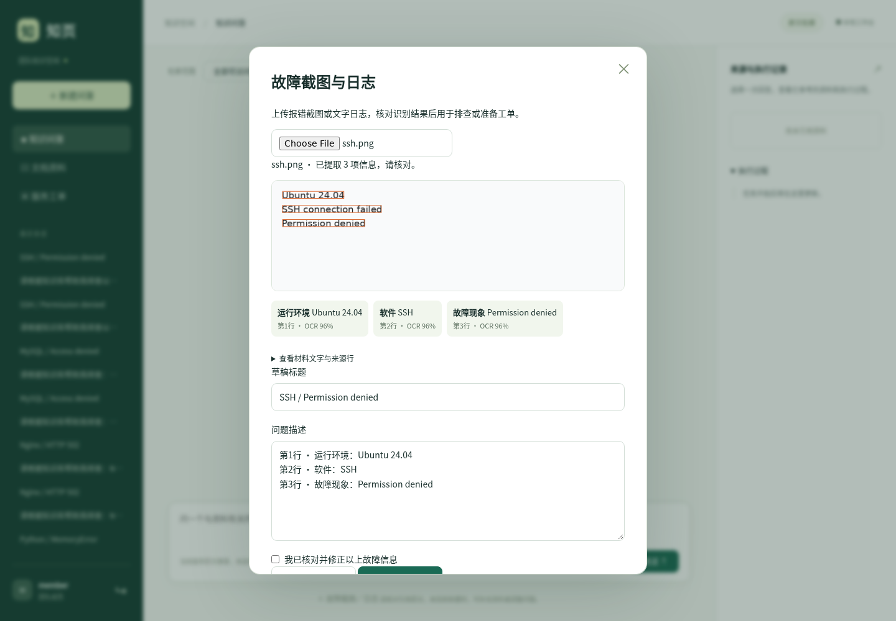
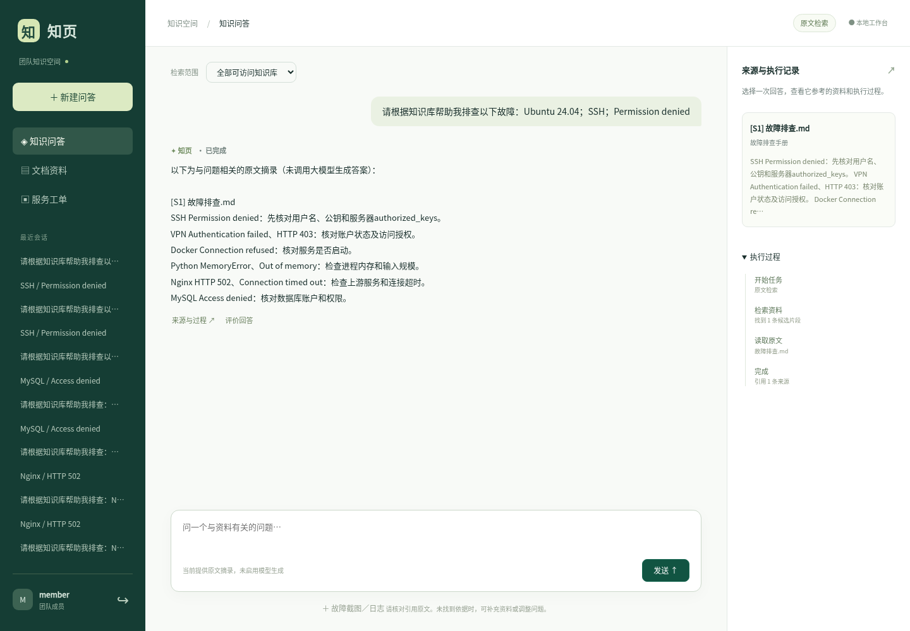
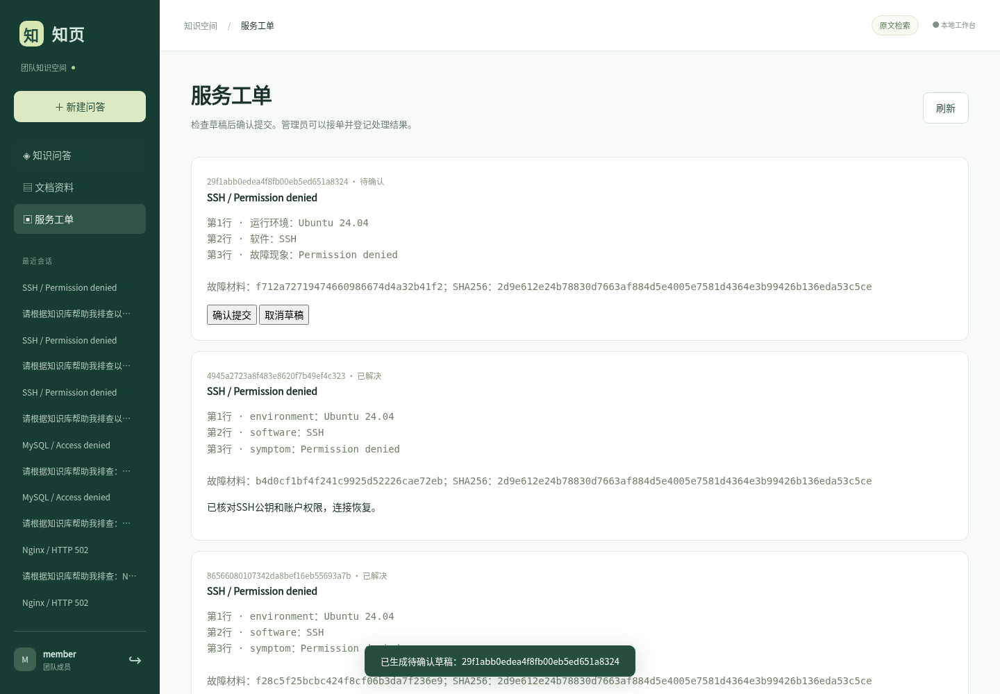
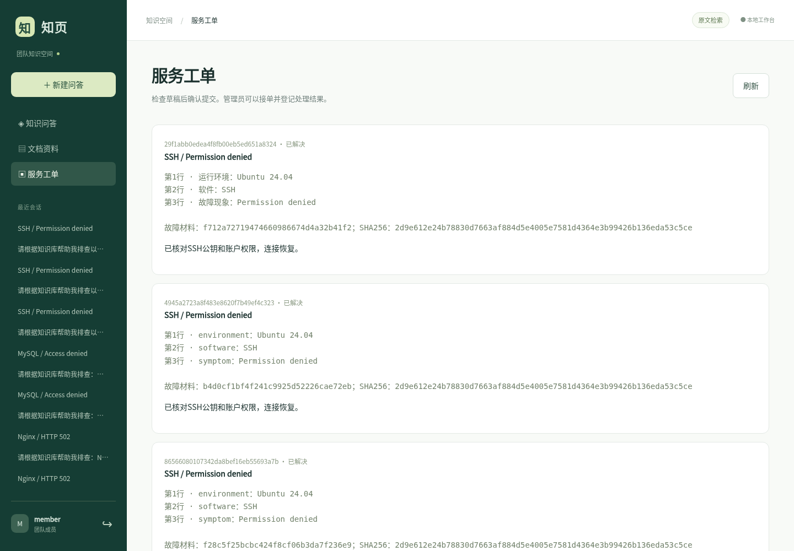

# strategy1 发布与验收材料

本轮实现保留主管Agent，加入执行进度与有限恢复、审核经验的检索和增量维护，以及故障截图／日志的字段来源定位、知识排查与确认建单。使用原Qwen3-8B，无后训练。

- [实现与模式说明](../../../CRM_STRATEGY1_20261114.md)
- [最终报告](report.md)、[总验收](verification.json)
- [四题真实模型对照](real-comparison.json)：相同开场，baseline2/4、experience4/4；Token76314→61742，模型调用52→40。此前66题分数保持原样。
- [代码检查去重统计](test-summary.json)：228项当前用例通过；XML分别保留。
- [故障材料验收](incident-summary.json)：12个合成样例、40字段；[改进前](incident-before.json)、[改进后](incident-after.json)均保留。
- [浏览器闭环](browser-result.json)：员工上传／核对／检索／提交→管理员处理→员工回查。
- [经验审核及反馈去重](experience-validation.json)、[源码清单](source-manifest.json)。

## 页面展示

部署说明和启用命令见实现文档。浏览器演示使用隔离数据及原文检索模式，材料为程序生成样例。模型、数据库、账号凭据、浏览器会话trace及模型缓存保留在/data。
